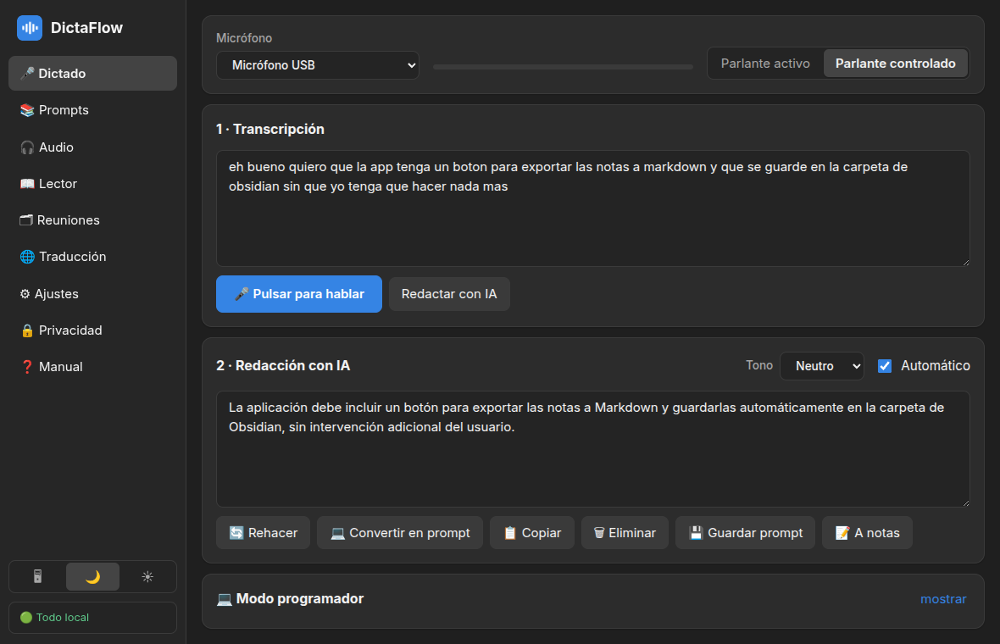

<p align="center"></p>
<h1 align="center">DictaFlow</h1>
<p align="center"><b>EN</b> Voice dictation with local AI · <b>ES</b> Dictado por voz con IA local<br>
Linux · Electron · MIT</p>

<p align="center"></p>

[English](#english) · [Español](#español)

---

## English

Speak, get clean text. DictaFlow turns your voice into polished writing, coding prompts, notes and audio — locally, or with the AI subscriptions you already have.

**Features:** dictation (continuous or push-to-talk, voice commands) · AI rewriting · prompt library + Prompt Architect agent · programmer mode (project context, send to Claude Code/opencode) · audio ↔ text with subtitles · PDF/EPUB reader with read-aloud and audiobook export · meeting transcription (mic + system audio) · live translation (ES↔EN) · personal dictionary · notes export (Obsidian-ready Markdown).

**Private by design:** speech recognition (Whisper) and voices (Piper) run on your machine. A status badge shows whether anything uses the cloud, the *Privacy* tab logs every outgoing request, and *strict offline mode* blocks all non-local connections.

### Install

Download from the [Releases](https://github.com/GMR027/dictaflow/releases/latest) page (or the project website).

| Distribution | Command |
|---|---|
| Ubuntu · Debian · Zorin · Mint · Pop!_OS | `sudo apt install ./dictaflow-linux-amd64.deb` |
| Fedora · RHEL · Rocky · Alma | `sudo dnf install ./dictaflow-linux-x86_64.rpm` |
| openSUSE | `sudo zypper --no-gpg-checks install ./dictaflow-linux-x86_64.rpm` |
| Arch · Manjaro · EndeavourOS | `sudo pacman -U ./dictaflow-linux-x86_64.pacman` |
| Any distribution | `chmod +x dictaflow-linux-x86_64.AppImage && ./dictaflow-linux-x86_64.AppImage` |
| Portable | `tar xzf dictaflow-linux-x64.tar.gz && ./dictaflow-linux-x64/dictaflow` |

Verify with `sha256sum -c SHA256SUMS.txt`. On first run the app detects your hardware and downloads the speech models (about 0.5–1.5 GB, once). Ollama is optional; the app can install it for you.

**Uninstall:** *Settings → Uninstall* shows the exact command for your installation and can run it (optionally deleting your data). Or: `sudo apt remove dictaflow` · `sudo dnf remove dictaflow` · `sudo pacman -R dictaflow` · delete the AppImage.

**Requirements:** Linux x86-64, graphical session (tested on GNOME/Wayland, Zorin OS), PipeWire for system-audio capture. AppImage may need `libfuse2` on some distributions.

**Known limitations:** no OCR for scanned PDFs · meeting speakers are labelled only "Me"/"System" · dictated text goes to the clipboard instead of being typed into other apps (Wayland does not allow that without risky permissions; register the shortcut from *Settings → Dictate in any app*).

### Build from source

```bash
git clone https://github.com/GMR027/dictaflow.git && cd dictaflow
npm install
node node_modules/electron/install.js   # if Electron did not download itself
npm run dev                              # development
npm run dist                             # AppImage, deb, rpm, pacman, tar.gz → release/
```
`.rpm` needs `rpm` and `.pacman` needs `libarchive-tools` installed. See [CONTRIBUTING.md](CONTRIBUTING.md).

---

## Español

Habla y obtén texto pulido. DictaFlow convierte tu voz en redacción, prompts de programación, notas y audio — en local, o con las suscripciones de IA que ya tienes.

**Herramientas:** dictado (continuo o pulsando para hablar, comandos de voz) · redacción con IA · biblioteca de prompts + agente Prompt Architect · modo programador (contexto del proyecto, envío a Claude Code/opencode) · audio ↔ texto con subtítulos · lector de PDF/EPUB con lectura en voz alta y audiolibro · transcripción de reuniones (micrófono + audio del sistema) · traducción en vivo (ES↔EN) · diccionario personal · exportación de notas (Markdown listo para Obsidian).

**Privado por diseño:** el reconocimiento de voz (Whisper) y las voces (Piper) se ejecutan en tu equipo. Una insignia indica si algo usa la nube, la pestaña *Privacidad* registra cada petición saliente y el *modo offline estricto* bloquea toda conexión no local.

### Instalación

Descarga desde [Releases](https://github.com/GMR027/dictaflow/releases/latest) (o desde la web del proyecto) y usa el comando de la tabla de arriba para tu distribución. Verifica con `sha256sum -c SHA256SUMS.txt`. Al primer inicio la app detecta tu hardware y descarga los modelos de voz (0,5–1,5 GB, una sola vez). Ollama es opcional y la app puede instalarlo.

**Desinstalar:** *Ajustes → Desinstalar* muestra el comando exacto de tu instalación y puede ejecutarlo (con opción de borrar tus datos).

**Requisitos:** Linux x86-64 con sesión gráfica (probado en GNOME/Wayland, Zorin OS) y PipeWire para capturar el audio del sistema.

**Limitaciones:** sin OCR para PDF escaneados · en reuniones los hablantes se etiquetan solo «Yo»/«Sistema» · el texto dictado va al portapapeles, no se escribe solo en otras apps (Wayland no lo permite sin permisos arriesgados; registra el atajo en *Ajustes → Dictar en cualquier app*).

---

## Project layout / Estructura

```
src/main       Electron main process (providers, speech worker, TTS, uninstall…)
src/renderer   React UI
src/shared     Types shared by both
site/          Bilingual static website (node site/build.mjs)
deploy/        Dockerfile, Helm chart and deploy script for the website
packaging/aur  PKGBUILD for the AUR
.github/       CI, release and site-image workflows
```

## License

[MIT](LICENSE) © 2026 GMR027 · [Third-party software](THIRD-PARTY.md)
